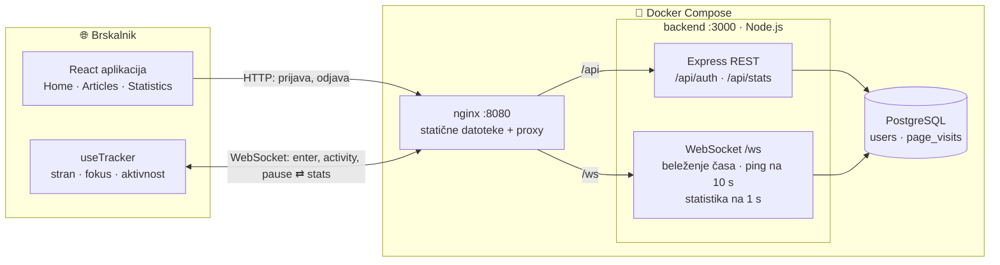
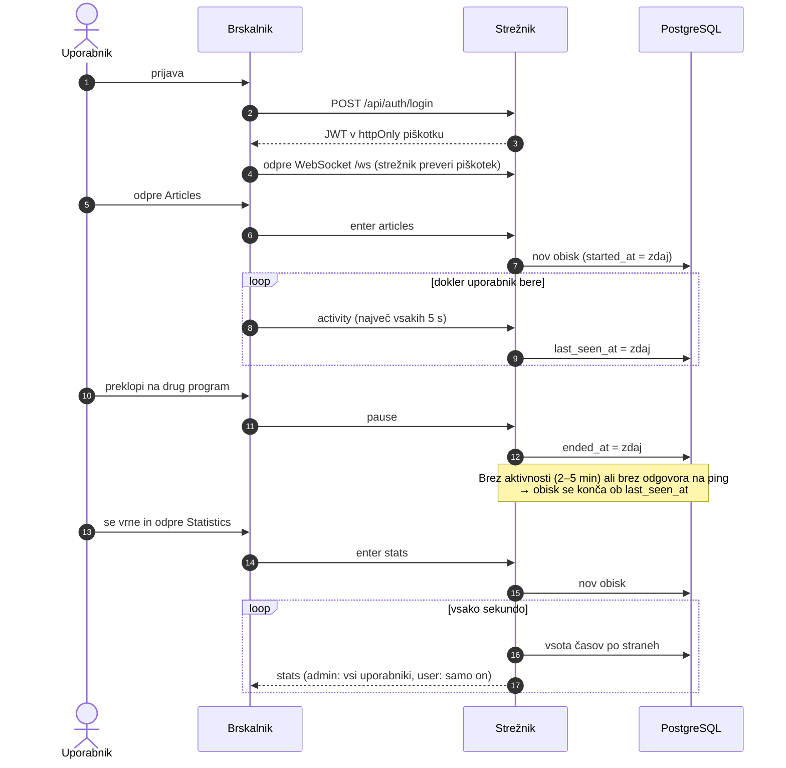

# (Time Tracker)

Spletna aplikacija, ki beleži, koliko časa vsak prijavljeni uporabnik preživi na
vsaki od treh strani (Home, Articles, Statistics). Čas se meri na backendu in
shranjuje v PostgreSQL. Stran s statistiko se posodablja v živo: uporabnik vidi
svoje podatke, admin vidi podatke vseh uporabnikov.

**Stack:** React + Vite (frontend, streže ga nginx) · Node.js + Express +
`ws` (backend) · PostgreSQL 16 · Docker Compose

## 1. Navodila za namestitev

Potrebno: Docker z Docker Compose.

```bash
docker compose up --build
```

Nato odprite **http://localhost:8080**.

- Na prijavni strani registrirajte nov račun (vsak nov račun je navaden uporabnik), ali
- se prijavite kot admin: **`admin` / `admin123`**

Privzete nastavitve delujejo brez kakršne koli konfiguracije. Za spremembo
kopirajte `.env.example` v `.env` in ga uredite:

| Spremenljivka                                         | Privzeto               | Namen                                                                   |
| ----------------------------------------------------- | ---------------------- | ----------------------------------------------------------------------- |
| `FRONTEND_PORT`                                       | `8080`                 | Vrata aplikacije v brskalniku (spremenite, če so 8080 zasedena)         |
| `BACKEND_PORT`                                        | `3000`                 | Vrata API-ja, samo za lokalni razvoj (spremenite, če so 3000 zasedena)  |
| `ADMIN_USERNAME` / `ADMIN_PASSWORD`                   | `admin` / `admin123`   | Admin račun, ustvarjen ob prvem zagonu                                  |
| `JWT_SECRET`                                          | `dev-secret-change-me` | Podpisuje prijavne žetone; **za resno uporabo ga obvezno spremenite**   |
| `POSTGRES_USER` / `POSTGRES_PASSWORD` / `POSTGRES_DB` | `tracker`              | Podatki za dostop do baze                                               |
| `IDLE_TIMEOUT_SECONDS`                                | (po straneh)           | En časovni prag neaktivnosti za vse strani, npr. `15` za hiter preizkus |

Ob zagonu backend izvede migracijo baze, ustvari admin račun (če še ne obstaja)
in zapre obiske, ki jih je odprte pustil prejšnji zagon.

### Lokalno (neobvezno)

```bash
docker compose up -d db backend   # baza + API na :3000
cd frontend && npm install && npm run dev   # aplikacija na http://localhost:5173
```

Vite posreduje `/api` in `/ws` backendu, enako kot nginx v Dockerju.
V `backend/requests.http` so primeri API requestov, v `backend/scripts/` pa
kratke testne skripte za WebSocket (zaženete jih z
`docker compose exec backend node scripts/<ime>.js`).

### Kako deluje

**Arhitektura** — kdo s kom govori:



**Potek obiska** — kako en uporabnik ustvari vrstice v bazi:



Vsak zavihek ima odprto eno WebSocket povezavo. Prek nje sporoča, katera stran
je odprta in ali je uporabnik aktiven; **strežnik** odloča, kdaj se čas začne
in ustavi, ter ga zapisuje v bazo. Vsak neprekinjen čas na eni strani je ena
vrstica v `page_visits` (`started_at`, `ended_at`, `last_seen_at`). Čas
uporabnika na strani je vsota njegovih vrstic za to stran; odprta vrstica
(`ended_at IS NULL`) se šteje do trenutnega trenutka.

## 2. Načrtovalske odločitve

### Kako se uporabniki prijavijo in kako ločimo admina od navadnega uporabnika?

- **Uporabniško ime in geslo.** Gesla so kriptirana z bcrypt. Registracija je
  odprta, vnos pa se preverja na strežniku.
- Po prijavi strežnik nastavi **JWT v httpOnly piškotku** (7 dni). JavaScript
  ga ne more prebrati, kar ga ščiti pred XSS; `sameSite: lax` ščiti pred CSRF.
  Ker nginx streže aplikacijo in API na istem izvoru (origin), piškotek deluje
  brez nastavljanja CORS.
- `users.role` je `'user'` ali `'admin'` (zagotavlja ga omejitev `CHECK`).
  **Registracija vedno ustvari navadnega uporabnika.** Edini admin se ustvari
  s seedom iz okoljskih spremenljivk, zato se nihče ne more sam narediti za admina.
- Vlogo **strežnik** prebere iz preverjenega žetona, tako v REST endpointu
  (`GET /api/stats`) kot v WebSocketu. Navaden uporabnik s spreminjanjem
  frontenda ne more dobiti statistike drugih: strežnik mu je nikoli ne pošlje.
- WebSocket preveri piškotek med HTTP "upgrade" zahtevkom, še preden je
  povezava sprejeta.

### Kako aplikacija zazna, da je uporabnik zaprl brskalnik ali izgubil povezavo?

Brskalnik ima odprto **WebSocket** povezavo, dokler je aplikacija odprta:

| Kaj se zgodi                                             | Kako se zazna                                                                                                                 | Kdaj se čas ustavi                                     |
| -------------------------------------------------------- | ----------------------------------------------------------------------------------------------------------------------------- | ------------------------------------------------------ |
| Zaprt zavihek ali brskalnik, odhod na drugo stran        | Povezava se takoj zapre                                                                                                       | Takoj                                                  |
| Odjava                                                   | `POST /api/auth/logout` zapre obisk in vse povezave tega uporabnika (koda 4001, zato se tudi drugi zavihki vrnejo na prijavo) | Takoj                                                  |
| Izgubljena povezava, zaprt prenosnik, sesutje brskalnika | Strežnik **pošlje ping vsakih 10 s**; povezava, ki ne odgovori, se prekine (v 10–20 s)                                        | Ob uporabnikovi **zadnji aktivnosti** (`last_seen_at`) |
| Sesutje ali ponovni zagon strežnika                      | Ob zagonu se zaprejo vsi še odprti obiski                                                                                     | Ob `last_seen_at`                                      |

Ker se obisk konča ob zadnji aktivnosti in ne v trenutku, ko je bila težava
opažena, mrtva povezava ali izpad strežnika nikoli ne dodata časa, ki ga
uporabnik ni zares preživel.

Povezanost še ne pomeni branja, zato strežnik preneha šteti tudi, ko:

- **Uporabnik ne gleda aplikacije.** Zavihek je skrit (drug zavihek,
  pomanjšano okno) ali okno ni v fokusu (spredaj je drug program). Brskalnik
  pošlje `pause`, ob vrnitvi pa ponovno `enter`.
- **Uporabnik je neaktiven.** Brskalnik sporoča aktivnost miške, tipkovnice,
  drsenja in dotika (največ vsakih 5 s). Brez aktivnosti 2 minuti na strani
  Home oziroma 5 minut na straneh Articles in Statistics (strani, ki jih
  bereš ali gledaš brez dotikanja) se obisk konča ob zadnji aktivnosti.
  Naslednja aktivnost začne nov obisk.

**Več zavihkov:** uporabnik je lahko hkrati samo na eni strani. To v bazi
zagotavlja delni unikatni indeks (en odprt obisk na uporabnika). Ko se začne
nov obisk, se uporabnikov drug odprt obisk zapre, zato se čas nikoli ne šteje
dvakrat; drug zavihek prikaže "another tab is active", dokler ga uporabnik
spet ne uporabi.

**Nadaljevanje po ponovni prijavi:** skupni časi so vedno vsota vseh shranjenih
obiskov, zato nova prijava preprosto doda nove vrstice k starim.

### Kakšno vsebino imajo strani in zakaj?

- **Home:** pozdrav in preprosta razlaga, kaj se beleži in kdaj se čas
  ustavi. Uporabnik naj ve, kaj se o njem meri.
- **Articles:** več kratkih člankov (o času na strani, poštenem merjenju,
  WebSocketih in mobile-first oblikovanju). Pri vsebini za branje "čas na
  strani" zares nekaj pomeni, zaznavanje neaktivnosti pa dobi realen primer.
- **Statistics:** uporabnikov čas po straneh, kot številke in stolpci z deležem
  posamezne strani, posodobljeno vsako sekundo. Oznaka **live** označuje
  stran, na kateri je uporabnik trenutno. Admin vidi kartico za vsakega
  uporabnika. Strežnik izračuna številke z eno poizvedbo na sekundo za vse
  gledalce skupaj in vsakemu pošlje samo tisto, kar dovoljuje njegova vloga;
  brskalnik jih samo prikaže.

Statusna vrstica pod glavo ves čas kaže, ali se čas šteje ("Tracking:
Articles", "Paused: no activity" …), tako da beleženje za uporabnika nikoli
ni skrivnost.

## 3. Prihodnje izboljšave

- **Varnost:** omejevanje števila poskusov (rate limiting) pri prijavi in
  registraciji, HTTPS z `COOKIE_SECURE=true`, obvezen močan `JWT_SECRET` v
  produkciji in možnost preklica žetonov pred potekom.
- **Funkcije za admina:** filter po obdobju (danes, zadnjih 7 dni), razvrščanje
  in iskanje uporabnikov ter grafi skozi čas. Podatki o vsakem obisku so že
  shranjeni.
- **Upravljanje računa:** sprememba gesla, izbris računa in upravljanje vlog
  s strani admina.
- **Dostopnost in uporabniška izkušnja:** temeljit pregled (bralniki zaslona,
  navigacija s tipkovnico) in kratko obvestilo "bili ste neaktivni".

## 4. Uporaba AI orodij

Skozi ves projekt mi je pomagal Claude Code (AI agent za programiranje).

- **Načrtovanje:** nalogo sva predelala skupaj in se dogovorila o
  tehnologijah, shemi baze in načrtu po korakih, z enim commitom na korak.
- **Backend:** narejen korak za korakom skupaj. AI je napisal posamezen del in
  ga razložil; jaz sem ga pregledal, spraševal, dokler ga nisem razumel, vsak
  korak sam zagnal in testiral (`requests.http`, testne skripte za WebSocket,
  preverjanje baze) in naredil vse commite. Nekatere odločitve so nastale iz
  mojega testiranja, na primer zaznavanje neaktivnosti po straneh in to, da
  se čas šteje samo, ko je okno res v fokusu.
- **Frontend:** večinoma ga je napisal AI (React aplikacija, tracker hook,
  stran s statistiko, stili, nginx in Docker). Testiral sem ga v brskalniku in
  na zaslonu velikosti telefona ter sporočil težave, ki so bile nato odpravljene.
- **Napake, najdene s testiranjem:** na primer, uporabniki so bili označeni
  kot "live" na straneh, ki jih sploh niso obiskali (napaka z `LEFT JOIN` +
  `BOOL_OR` v poizvedbi za statistiko).

## 5. Izzivi

- **Prva celotna aplikacija.** To je moja prva celotna aplikacija, zato je to zame
  bil dodaten izziv.
- **Kaj sploh je "čas na strani".** Najtežja ni bila koda, ampak odločitev,
  kaj naj se šteje: skrit zavihek, vidno okno za drugim programom, odprt
  zavihek, ki se ga nihče ne dotika, dva zavihka hkrati. Vsak odgovor je
  zahteval drug mehanizem (vidnost, fokus, aktivnost, en odprt obisk na
  uporabnika).
- **Pošteno zaznavanje izgubljene povezave.** Zaprt zavihek je enostaven, mrtvo
  omrežno povezavo pa TCP opazi šele po dolgem času. Rešitev je bil ping/pong
  heartbeat in zaključevanje takih obiskov ob zadnji aktivnosti, ne ob
  trenutku, ko je bila težava opažena.
- **Tekmovalna stanja (race conditions).** Dva zavihka, ki začneta obisk v
  istem trenutku, ali sporočila ene povezave, obdelana v napačnem vrstnem redu.
  Rešeno z zaklepanjem vrstice v transakciji baze in čakalno vrsto za vsako
  povezavo.

## 6. Odprta vprašanja

- **Ali se šteje zavihek v ozadju?** Naloga pravi, da se beleži čas na strani,
  ne pa, kaj pomeni "biti na strani". Odločitev: čas se šteje samo, ko
  uporabnik aplikacijo res gleda — viden zavihek, okno v fokusu in nekaj
  aktivnosti v zadnjih nekaj minutah. To je moja lastna izbira; preprostejša
  razlaga ("stran je odprta") bi naštela precej več časa.
- **Kako dolgo je "neaktiven"?** Pravilne številke ni. Izbral sem 2 minuti za
  Home in 5 za strani z branjem, nastavljivo prek `IDLE_TIMEOUT_SECONDS`.
- **Ali se beleži tudi admin?** Predpostavka: da. Admin je tudi uporabnik
  aplikacije, zato se njegov čas beleži in prikazuje kot pri vseh drugih.
- **Več zavihkov.** Naj se dva odprta zavihka štejeta dvakrat ali enkrat?
  Odločitev: enkrat (zmaga nazadnje uporabljen zavihek), ker človek hkrati
  bere samo eno stran.
- **Kako nastane admin?** Ni bilo določeno. Izbral sem seed iz okoljskih
  spremenljivk, tako da registracija nikoli ne more ustvariti admina.
